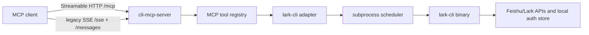

# lark-cli MCP Wrapper Design

## 目标

这个 server 的目标是把本机 `lark-cli` 包装成 MCP tool server，让其他 MCP client 可以通过
Streamable HTTP 或 legacy SSE 调用飞书 / Lark 能力。

边界很明确：

- 调用本机 `lark-cli` 二进制，不链接、不 fork、不改 `lark-cli` 源码。
- 暴露 curated tool surface，不开放任意命令、任意 shell 或任意 argv。
- 授权沿用 `lark-cli auth`；wrapper 只保管设备流所需的短期、一次性 server-side handle。
- 默认本机使用，外部暴露时必须加访问控制。

## 可行性判断

这个方案可行，而且适合作为第一阶段。

原因：

- `lark-cli` 已经有稳定的 CLI 合同：JSON 输出、`auth login --no-wait --json`、`auth login --device-code`、
  `auth qrcode --ascii`、`skills list/read`、`drive/docs/event/api` 等命令面。
- MCP tool 调用天然适合把一个受控命令映射成一个 typed tool。
- 进程级 wrapper 可以快速隔离风险：每次调用独立进程、可设置 timeout、输出上限、并发上限和队列上限。
- Streamable HTTP 与 legacy SSE 可以共享同一组 tool adapter，不需要复制业务逻辑。

不建议第一阶段直接改 `lark-cli` 官方源码。真正难点不是加一个 `mcp-server` 子命令，而是：

- MCP session 生命周期。
- Streamable HTTP 与 legacy SSE 兼容。
- wrapper 自身鉴权。
- 子进程并发、排队、超时、输出截断。
- 授权流程对 agent 的非阻塞支持。
- 写操作确认、安全边界和审计。

先用 Node wrapper 固化行为合同，再按同一合同迁到 Go 或 upstream，会更稳。

## 架构

核心分层：

- Transport layer：`/mcp`、`/sse`、`/messages`、`/health`。
- Tool layer：MCP `tools/list` 和 `tools/call`。
- Adapter layer：`src/tools.js` 把 tool arguments 转成白名单 `lark-cli` argv。
- Scheduler layer：控制子进程并发、队列、timeout 和输出大小。
- Binary layer：真实执行 `lark-cli`。

## Transport

支持两种入口：

- Streamable HTTP：`POST /mcp` 初始化和调用，`GET /mcp` 建立可选 SSE stream，`DELETE /mcp` 关闭 session。
- Legacy SSE：`GET /sse` 建立 stream，`POST /messages?sessionId=...` 发送 JSON-RPC message。

两者共享同一个 `createServer()` 和同一组 tools，但 session map 分开，避免 client 拿错协议的 session ID。
Streamable HTTP session 有最大数量和 idle TTL；客户端未发送 DELETE 时也会自动回收。

## 子进程调度

所有 `lark-cli` 调用都经过 `runLarkCli()`：

- `spawn("lark-cli", args, { shell: false })`，不经 shell。
- 每次调用独立 request ID。
- 默认 timeout：`120000ms`。
- 默认 stdout/stderr 各截断到 `8 MiB` 字符。
- 默认最大并发：`LARK_CLI_MCP_MAX_CONCURRENCY`，未设置时为 `4`。
- 默认最大队列：`LARK_CLI_MCP_MAX_QUEUE`，未设置时为 `64`。
- timeout 先发送 `SIGTERM`，短暂 grace 后仍未退出则发送 `SIGKILL`；server shutdown 同时清空排队任务并终止活跃子进程。

`lark_runtime_status` 和 `/health` 会返回 scheduler counters，便于 MCP client 判断 wrapper 是否繁忙。

## 授权

授权不在 wrapper 内重写。wrapper 只把 `lark-cli auth` 做成 agent-friendly MCP tools：

- `lark_auth_status`：完成 context/App/identity preflight 后读取并脱敏当前身份状态。
- `lark_auth_login_start`：preflight 成功后执行 `lark-cli auth login --no-wait --json`；server 内存保存
  `device_code`，只向 caller 返回 URL、user code 和 10 分钟有效的一次性 opaque handle。
- `lark_auth_login_complete`：以相同 frozen execution contract 消费 handle，再由 server 执行
  `lark-cli auth login --device-code ... --json`；raw device code 不进入 MCP context。

这解决了 agent 场景里最常见的问题：首次调用不能阻塞等用户打开浏览器。MCP client 可以先把 URL 或 QR 给用户，
等用户确认后再调用 complete。

## 当前工具面

第一阶段只暴露低风险和可控工具：

- Auth：`lark_auth_status`、`lark_auth_login_start`、`lark_auth_login_complete`。
- Runtime：`lark_runtime_status`、`lark_profile_list`、`lark_doctor_offline`。
- Skills：`lark_skills_list`、`lark_skill_read`。
- Read-oriented document tools：`lark_drive_inspect`、`lark_drive_search`、`lark_docs_fetch`。
- Events：`lark_event_list`、`lark_event_schema`、`lark_event_consume_bounded`。
- API preview：`lark_api_dry_run`。

不开放：

- 任意 shell。
- 任意 argv。
- `--yes`。
- 真实 raw API 执行工具。
- 发送消息、写文档、改权限、删除、发布等写操作。

## 安全边界

当前 wrapper 继承本机 `lark-cli` 权限，因此默认只监听 `127.0.0.1`。

除 runtime/profile/skills/event catalog discovery 外，所有 tool 都要求 frozen execution contract：
`context`、`profile`、独立锚定的 `expectedAppId`、`identity`。wrapper 使用显式 `--profile` 做
`config show`、`whoami --as ...`、`auth status --json --verify` 三步 preflight，随后在业务 argv 上持续
携带相同 `--profile` 与 `--as`。环境变量只用于判断 MCP 进程实际是 channel 还是 system context。

如果需要给其他进程或内网机器用：

- 设置 `LARK_CLI_MCP_BEARER_TOKEN`。
- 非 loopback 监听在没有 bearer token 时会拒绝启动；设置 token 后所有 transport 和 `/health` 都要求鉴权。
- SDK Express host validation 拒绝异常 Host，降低本机无 bearer 时的 DNS rebinding 风险。
- 优先放在本机 agent runtime 或受控反向代理后面。
- 不要把公网地址直接暴露到 wrapper。
- 不要把真实 verification URL、device code、token、app secret、私有文档内容写入公开日志、文档或测试快照；
  `lark-cli` 错误只返回受控类型、固定提示、request ID 和进程状态；validation 类错误返回脱敏短消息，
  两者都不返回 raw argv/stdout/stderr。

## Node、Go、Upstream 的取舍

Node wrapper 适合现在：

- MCP TypeScript SDK 直接支持 Streamable HTTP 和 SSE。
- 开发和 smoke 验证快。
- 便于把工具合同先跑稳定。
- 不侵入 `lark-cli` 源码，升级 `lark-cli` 也简单。

Go wrapper 适合第二阶段：

- 单二进制部署。
- 和 `lark-cli` 的 Go 生态更接近。
- 更容易做长期 daemon、system service 和资源治理。

Upstream 到 `lark-cli` 适合第三阶段：

- 工具合同稳定以后，把 MCP server 作为官方 `lark-cli mcp-server` 子命令。
- 需要复用现有 auth/config/runtime 包，并补齐 transport、安全、确认和审计机制。

建议顺序：

1. Node wrapper 做行为基线。
2. `src/tools.js` 作为独立 tool adapter，配套 contract tests 固化行为。
3. 增加更多只读工具。
4. 引入写操作前先设计确认协议和 allowlist。
5. 再评估 Go 迁移或 upstream。

## 已完成的工程化收口

- `server.js` 只保留 MCP transport、session 和 endpoint 处理。
- `tools.js` 独立维护 `TOOLS` 和 `callTool()` / argv adapter。
- `contract-tools.mjs` 直接验证 execution preflight、schema、argv、一次性 OAuth handle、错误脱敏和 forbidden args。
- smoke 覆盖 health、legacy SSE、Streamable HTTP、session cleanup、scheduler 和 auth split-flow。

## 后续范围

当前 MVP 只覆盖上述白名单工具。Base/Sheets/export、真实写操作、运行日志和 Go/upstream 迁移均不在本次交付内；
其中任何写操作都必须先另行设计 confirmation contract，不能直接复用 raw argv。
